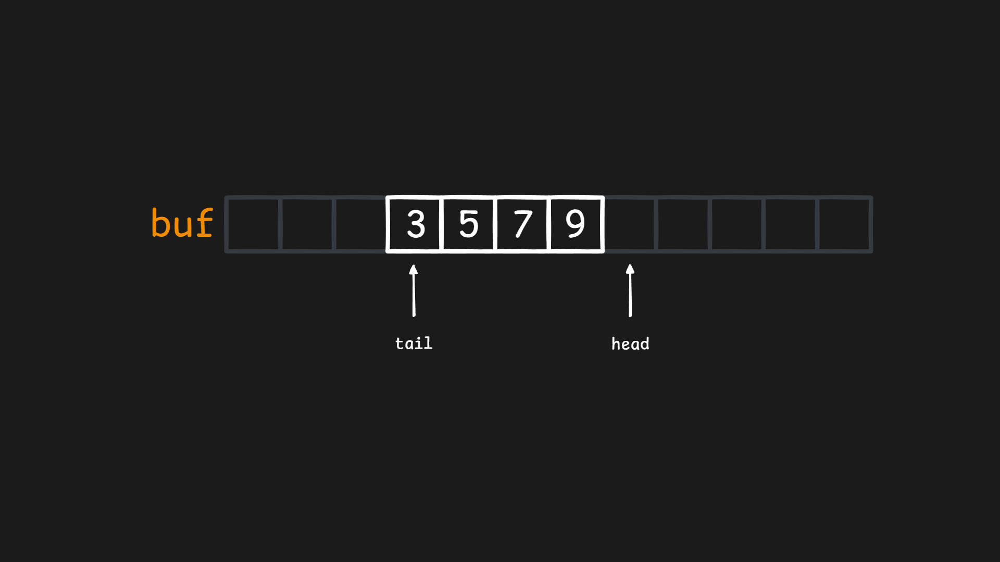
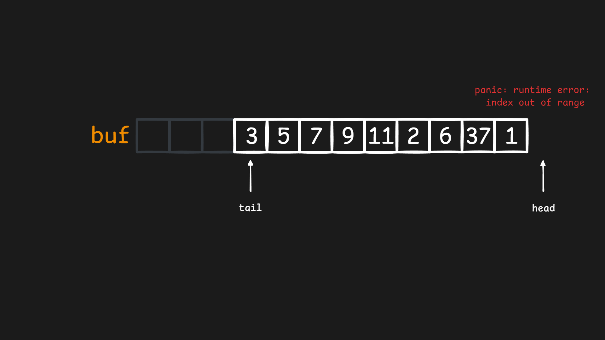
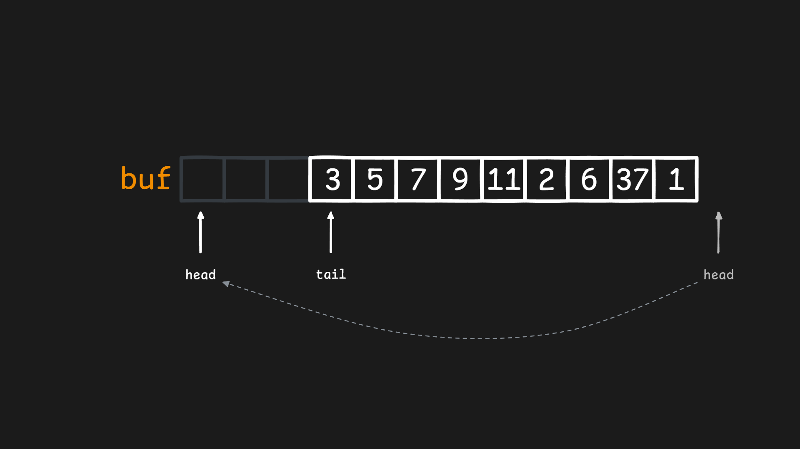

# Circular buffer

Очередь - это одна из самых логичных и понятных структур данных, потому что мы сталкиваемся с очередью постоянно. Кроме того, очередь одна из самых часто используемых структур данных. Можно найти множество примеров, когда в ходе обработки каких-то данных нам нужно добавить новые элементы и вполне логично использовать для этого очередь.

Основу любой очереди составляют 2 операции

- `Put` - положить элемент в конец очереди
- `Get` - взять первый элемент из очереди

Полезно также будет знать сколько элементов сейчас находится в очереди, пустая ли очередь и является ли она заполненной.

- `Len` - количество элементов в очереди
- `IsEmpty` - является ли очередь пустой
- `IsFull` - является ли очередь заполненной

Многие вещи в программирование можно реализовать по разному и очередь относится к так называемым абстрактным типам данных (АТД). Это означает что нет единого способа реализовать очередь, но есть 2 основных - на основе кольцевого буфера и связного списка. Именно очередь на основе кольцевого буфера (`circular buffer`) мы и будем реализовывать сегодня. Технически мы реализуем кольцевой буфер, но он также является очередью, поэтому эти термины будут использоваться как синонимы.

Основу очереди в нашей реализации будет состовлять обычный массив `buf`. Чтобы отслеживать начало и конец очереди, добавим 2 указателя (индекса) 

- `head` (голова) - указывает на место в массиве, куда нужно положить значение при следующем вызове `Put`. Добавление элемента в начало очереди должно увеличивать `head` на 1.
- `tail` (хвост) - указывает на элемент в массиве, который нужно вернуть при следующем вызове `Get`. Возвращение элемента из конца очереди должно увеличивать `tail` на 1.



Начальныные значения для `head` и `tail` - это 0. Для `head` это логично, потому что для пустого массива мы добавим новый элемент в самое начало массива. Операция `Get` не должны выполняться, когда элементов в очереди нет, и первый элемент который вернется из очереди после вызова `Put` также будет по индексу `0`.

Массив (в нашем случае это слайс, но я использую эти термины взаимозаменяемо в данном контексте, потому что в нашем случае мы не будем изменять размер слайса), который хранит данные, имеет конечный размер, и этот размер будет сохранен в переменной `cap` (capacity - емкость).

Теперь мы можем реализовать первую версию кольцевого буфера (очередь может хранить любые типы, поэтому используются дженерики)

```go

type CircularBuffer[T any] struct {
    buf []T
    cap int
    head int
    tail int
}

func NewCircularBuffer[T any](cap int) *CircularBuffer[T] {
    return &CircularBuffer[T]{
        cap: cap,
        buf: make([]T, cap),
        head: 0,
        tail: 0,
    }
}

func (c *CircularBuffer[T]) Put(v T) {
    c.buf[c.head] = v
    c.head++
}

func (c *CircularBuffer[T]) Get() T {
    value := c.buf[c.tail]
    c.tail++
    return value
}
```

Первое время такая очередь даже будет работать, но до тех пор, пока мы не выйдем за пределы выделенного массива. Это приведет к ошибке.



Конечно можно перевыделить новый массив и скопировать туда все элементы, но это будет очень долго. Если посмотреть на изображении, то мы увидим, что между началом массива и указателем `tail` есть значения, которые уже не нужны (очередь хранит элементы только от `tail` до `head`). Именно туда мы будет добавлять новые элементы, когда `head` дойдет до конца массива `buf`. Реализовать это можно с помощью операции взятия остатка от деления размера массива. Если `cap` - это размер массива, то любое значение `n % cap` будет возвращать значения от `0` до `cap - 1` (включительно). Операция обновления `head` будет выглядеть так: `head = (head + 1) % cap`. Аналогично для `tail`: `tail = (tail + 1) % cap`.



Структура данных называется кольцовым (circular) буфером потому что буфер как бы образует кольцо. Но сейчас в определенный момент `head` может догнать `tail` и перезаписать значения, которых хранятся в начале очереди. Чтобы этого не допустить, мы добавим к структуре поле `len` - сколько элементов сейчас в очереди. Если `len == 0` - очередь пуста. Если `len == cap` - очередь заполнена.

Добавим методы `Len`, `IsEmpty` и `IsFull`

```go
func (c *CircularBuffer[T]) Len() int {
    return c.len
}

func (c *CircularBuffer[T]) IsEmpty() bool {
    return c.len == 0
}

func (c *CircularBuffer[T]) IsFull() bool {
    return c.len == c.cap
}
```

Добавлять в очередь можно только если она не заполнена. Брать из очереди можно только если она не пуста. Добавление в очередь увеличивает `len`. Взятие из очереди уменьшает `len`. Методы `Put` и `Get` теперь будут выглядеть так

```go
func (c *CircularBuffer[T]) Put(v T) {
	if c.IsFull() {
		// ...
	}
	c.buf[c.head] = v
	c.head = (c.head + 1) % c.cap
	c.len++
}

func (c *CircularBuffer[T]) Get() T {
	if c.IsEmpty() {
		// ...
	}
	value := c.buf[c.tail]
	c.tail = (c.tail + 1) % c.cap
	c.len--
	return value
}
```

Что должно произойти, если мы пытаемся добавить в заполненную очередь или взять из пустой очереди, зависит от конкретной реализации. Можно паниковать (нежелательно), можно возвращать ошибку (предпочтительнее), можно просто возвращать `true/false` как факт успешности выполнения операции. Добавим возврат ошибки.

```go
var ErrCircularBufferIsEmpty = errors.New("circular buffer is empty")
var ErrCircularBufferIsFull = errors.New("circular buffer is full")

func (c *CircularBuffer[T]) Put(v T) error {
	if c.IsFull() {
		return ErrCircularBufferIsFull
	}
	c.buf[c.head] = v
	c.head = (c.head + 1) % c.cap
	c.len++
	return nil
}

func (c *CircularBuffer[T]) Get() (T, error) {
	if c.IsEmpty() {
		var zero T
		return zero, ErrCircularBufferIsEmpty
	}
	value := c.buf[c.tail]
	c.tail = (c.tail + 1) % c.cap
	c.len--
	return value, nil
}
```

Чтобы лучше понимать как данные располагаются в памяти, добавим 2 метода

- `Dump` - возвращает значения в массиве `buf` как есть, как они хранятся в памяти
- `Values` - возвращает элементы в массиве `buf` как они будут возвращаться при последовательных вызовах `Get`, т.е. как они логически расположены в очереди

```go
func (c *CircularBuffer[T]) Dump() []T {
	values := make([]T, c.cap)
	copy(values, c.buf)
	return values
}

func (c *CircularBuffer[T]) Values() []T {
	values := make([]T, 0, c.len)
	for i := range c.len {
		idx := (i + c.tail) % c.cap
		values = append(values, c.buf[idx])
	}
	return values
}
```

Метод `Dump` нужен только чтобы лучше понимать расположение данных в памяти, в настоящих реализациях лучше это метод не добавлять.

Посмотрим на работу этих методов на примере. Создадим кольцевой буфер на 5 элементов, добавим 4 элемента: `[1, 2, 3, 4]`, затем получим из очереди 3 элемента и добавим еще 2 `[5, 6]`. В очереди осталось 3 элемента `[4, 5, 6]`, но фактическое содержание буфера - это `[6, 2, 3, 4, 5]`

```go
cb := NewCircularBuffer[int](5)
cb.Put(1)
cb.Put(2)
cb.Put(3)
cb.Put(4)
_, _ = cb.Get()
_, _ = cb.Get()
_, _ = cb.Get()
cb.Put(5)
cb.Put(6)
fmt.Println(cb.Dump())
fmt.Println(cb.Values())
```
