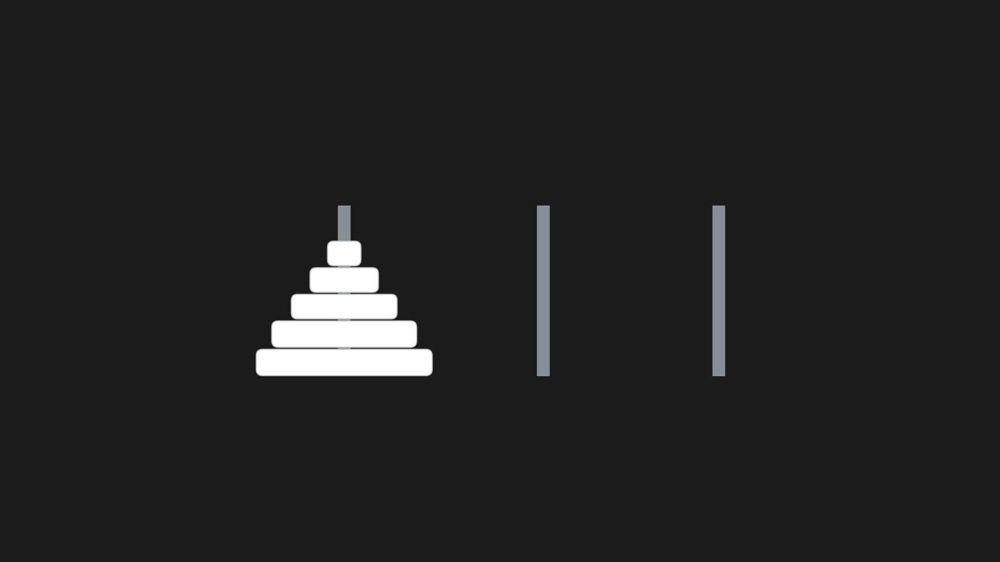
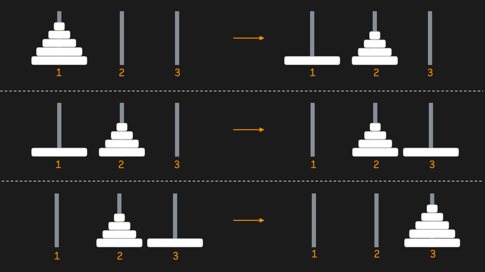

# Tower of Hanoi

Ханойская башня - это головоломка, придуманная французским математиком Эдуардом Люка в 1883. 

Есть 3 стержня. на один из стержней нанизаны `N` колец в виде пирамиды (каждое нижнее кольцо больше верхнего). Задача состоит в том, чтобы перенести все кольца с одного стержня на другой с двумя важными ограничением:

- за один раз можно перенести только 1 кольцо
- кольцо большего размера нельзя класть на кольцо меньшего размера



Алгоритмическое решение это задачи очень красивое и знакомит с очень важным паттерном разделяй и властвуй (`divide and conquer`), а также рекурсией.

Ключевая идея в том, что решение состоит из 3-х шагов. Назовем стержни `1`, `2` и `3` соответственно. Нужно перенести все диски со стержня `1` на стержень `3`.

1. Перенести `N-1` диск со стрежня `1` на стержень `2`
2. Перенести самый большой диск со стержня `1` на стержень `3`
3. Перенести `N-1` дисков со стержня `2` на стержень `3`



Функция `toh` демонстрирует это решение. Она принимает `n` - сколько колец нужно перенести, с какого стержня и на какой. Если нужно перенести одно кольцо - мы можем сделать это прямо сейчас. Если больше - то руководствуемся логикой выше.

```go
func toh(n int, from int, to int, temp int) {
	if n == 1 {
		fmt.Printf("%d -> %d\n", from, to)
		return
	}
	toh(n-1, from, temp, to)
	toh(1, from, to, temp)
	toh(n-1, temp, to, from)
}
```

Вывод этого алгоритма показывает с какого стержня нужно взять самое верхнее кольцо и на какой стержень его нужно перенести.

```
1 -> 3
1 -> 2
3 -> 2
1 -> 3
2 -> 1
2 -> 3
1 -> 3
```

Принцип разделяй и властвуй здесь используется в следующем виде. Вместо того, чтобы решить задачу по перенесению `N` колец с одного стержня на другой, нам нужно решить 2 задачи попроще (перенесение `N-1` кольц с одного стержня на другой) и одну совсем тривиальная - перенести одно кольцо с одного стержня на другой. Формально это можно записать так: `T(n) = 2T(n-1) + O(1)`. А рекурсия выражена в том, что в функции решения мы вызываем эту же функцию, но с параметрами, которые делают задачу проще.
