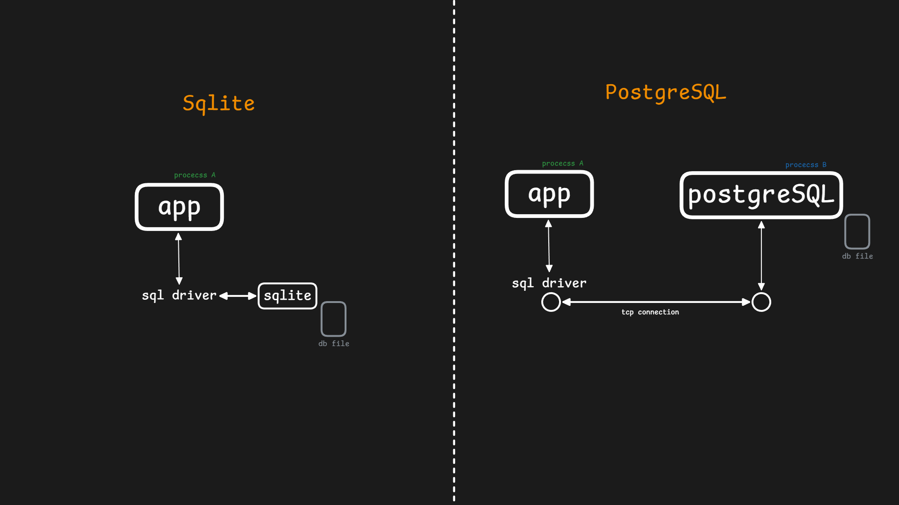

# Console-based task menegement app

В задаче сегодняшнего дня мы будем писать консольное приложение для управления задачами. Задачи будут сохранятьтся используя `sqlite`.

`sqlite` - это встраиваемая библиотека, которая позволяет приложению работать с базой данных напрямую, без промежуточных процессов. В отличие от `MySQL` или `PostgreSQL`, которые запускают отдельный процесс и принимают запросы через tcp сокеты, `sqlite` хранит, пишет и читает напрямую файл базы данных. Если все упростить - `sqlite` управляет базой данных в обычном файле и предоставляет знакомый `sql` API (`SELECT`, `INSERT`, `UPDATE`, `DELETE` и прочее). Для консольных приложений `sqlite` подходит лучше всего.



Наше приложение будет иметь вариант консольной утилиты со следующими возможностями:

- добавление новой задачи с указанным описанием
- отображение всех задач
- отображение задач с указанным статусом (todo, inporgress, done)
- обновление статуса задачи (todo -> inprogress, inprogress->done)
- удаление задачи по `id`
- отображение задачи по `id`

Начнем с описания того, что такое задача. Это структура с всего 3-мя полями

- `id` - уникальный идентификатор задачи
- `title` - краткое описание задачи
- `status` - один из 3-х возможных статусов
    - `to do` - задача запланирована
    - `in progress` - задача в работе
    - `done` - задача выполнена

```go
type TaskStatus int

const (
	TaskStatusToDo = iota
	TaskStatusInProgress
	TaskStatusDone
)

type Task struct {
	ID     int
	Title  string
	Status TaskStatus
}

func NewTask(title string) *Task {
	return &Task{
		ID:     -1,
		Title:  title,
		Status: TaskStatusToDo,
	}
}

func (t *Task) String() string {
	return fmt.Sprintf("#%d %s [%s]", t.ID, t.Title, t.Status)
}
```

Новая задача создается с `id=-1`. Настоящее `id` появится тогда, когда задача будет добавлена в базу данных.

Следующий уровень - репозиторий. Это структура, которая предоставлят абстракция доступа к данным. Для работы с любой базой данных нужен драйвер - посредник между СУБД и приложением. В нашем приложении мы будем использовать `github.com/mattn/go-sqlite3`. При создании репозитория мы сразу открываем файл с данными, выполняем скрипт по созданию таблицы с задачами, и возвращаем указатель на созданную структуру репозитория.

```go
type Repository struct {
	db *sql.DB
}

func NewRepository(dbpath string) (*Repository, error) {
	db, err := sql.Open("sqlite3", dbpath)
	if err != nil {
		return nil, err
	}
	_, err = db.Exec(createTasksQuery)
	if err != nil {
		return nil, err
	}
	return &Repository{
		db: db,
	}, nil
}

func (r *Repository) Close() error {
	return r.db.Close()
}
```

Запрос на создание выглядит так. Если таблица уже существует, ничего не будет выполнено (условие `IF NOT EXISTS`).

```go
const createTasksQuery = `CREATE TABLE IF NOT EXISTS tasks (
    id INTEGER PRIMARY KEY AUTOINCREMENT,
    title TEXT NOT NULL,
    status INTEGER DEFAULT 0
);`
```

Немного поговорим об архитектуре приложения. Это минималистичное консольное приложение, где мы запускаем исполняемый файл, указываем команду и аргументы, приложение обрабатывает ввод, и выполняет команду или возвращает ошибку.

Подготовим шаблон для `main`. Здесь мы создаем структуру репозитория, получаем команду как аргумент при запуске и все что останется - в зависимости от команды вызывать методы репозитория (которые будут работать с базой данных)

```go
func main() {
	repository, err := NewRepository("data.db")
	if err != nil {
		fmt.Println("cannot init sqlite database")
		os.Exit(1)
	}
	defer repository.Close()
	args := os.Args[1:]
	if len(args) == 0 {
		fmt.Println("command not specified")
		fmt.Println(help)
		os.Exit(1)
	}
	cmd := args[0]
	switch cmd {
        //...
    }
```

Начнем добавлять методы в репозиторий:

- добавление новой задачи

```go
const insertTaskQuery = `INSERT INTO tasks (title, status) VALUES (?, ?);`

func (r *Repository) CreateTask(title string) (*Task, error) {
	task := NewTask(title)
	res, err := r.db.Exec(insertTaskQuery, task.Title, task.Status)
	if err != nil {
		return nil, err
	}
	id, err := res.LastInsertId()
	if err != nil {
		return nil, err
	}
	task.ID = int(id)
	return task, nil
}
```

- Получение задачи по `id`

```go
const selectTaskByIdQuery = `SELECT id, title, status FROM tasks WHERE id = ?;`

func (r *Repository) GetTaskById(taskId int) (*Task, error) {
	var task Task
	if err := r.db.QueryRow(selectTaskByIdQuery, taskId).Scan(&task.ID, &task.Title, &task.Status); err != nil {
		return nil, err
	}
	return &task, nil
}
```

- Получение всех задач

```go
const selectAllTasksQuery = `SELECT id, title, status FROM tasks;`

func (r *Repository) GetAllTasks() ([]*Task, error) {
	rows, err := r.db.Query(selectAllTasksQuery)
	if err != nil {
		return nil, err
	}
	defer rows.Close()
	tasks := make([]*Task, 0)
	for rows.Next() {
		var task Task
		if err := rows.Scan(&task.ID, &task.Title, &task.Status); err != nil {
			return nil, err
		}
		tasks = append(tasks, &task)
	}
	if err := rows.Err(); err != nil {
		return nil, err
	}
	return tasks, nil
}
```

- Получение задач в указанном статусе

```go
const selectTasksWithStatusQuery = `SELECT id, title, status FROM tasks WHERE status = ?;`

func (r *Repository) GetTasksByStatus(status TaskStatus) ([]*Task, error) {
	rows, err := r.db.Query(selectTasksWithStatusQuery, status)
	if err != nil {
		return nil, err
	}
	defer rows.Close()
	tasks := make([]*Task, 0)
	for rows.Next() {
		var task Task
		if err := rows.Scan(&task.ID, &task.Title, &task.Status); err != nil {
			return nil, err
		}
		tasks = append(tasks, &task)
	}
	if err := rows.Err(); err != nil {
		return nil, err
	}
	return tasks, nil
}
```

- Изменение статуса задачи

```go
const updateTaskStatusQuery = `UPDATE tasks SET status = ? WHERE id = ?;`

func (r *Repository) ChangeTaskStatus(taskId int, newStatus TaskStatus) error {
	res, err := r.db.Exec(updateTaskStatusQuery, newStatus, taskId)
	if err != nil {
		return err
	}
	if n, _ := res.RowsAffected(); n == 0 {
		return fmt.Errorf("task #%d not found", taskId)
	}
	return nil
}
```

- Удаление задачи

```go
const deleteTaskByIdQuery = `DELETE FROM tasks WHERE id = ?;`

func (r *Repository) DeleteTaskById(taskId int) error {
	res, err := r.db.Exec(deleteTaskByIdQuery, taskId)
	if err != nil {
		return err
	}
	if n, _ := res.RowsAffected(); n == 0 {
		return fmt.Errorf("task #%d not found", taskId)
	}
	return nil
}
```

Теперь можно реализовать проверку аргументов в `main` и вызов соответствующих методов репозитория. Полный исходный код можно найти в файлах `main.go`, `task.go` и `repository.go`, здесь показана только структура.

```go
func main() {
	repository, err := NewRepository("data.db")
	if err != nil {
		fmt.Println("cannot init sqlite database")
		os.Exit(1)
	}
	defer repository.Close()
	args := os.Args[1:]
	if len(args) == 0 {
		fmt.Println("command not specified")
		fmt.Println(help)
		os.Exit(1)
	}
	cmd := args[0]
	switch cmd {
	case "add":
		// ...
		task, err := repository.CreateTask(title)
        // ...
		fmt.Printf("task \"%s\" created with id #%d\n", task.Title, task.ID)
	case "id":
        // ...
		task, err := repository.GetTaskById(taskId)
        // ...
		fmt.Printf("#%d %s [%s]\n", task.ID, task.Title, task.Status.String())
	case "list":
		tasks, err := repository.GetAllTasks()
		// ...
		n := len(tasks)
		fmt.Println("--- all tasks ---")
		for i, task := range tasks {
			fmt.Printf("[%d/%d] #%d %s [%s]\n", i+1, n, task.ID, task.Title, task.Status.String())
		}
	case "status":
		// ...
		tasks, err := repository.GetTasksByStatus(status)
		// ...
		n := len(tasks)
		fmt.Printf("--- tasks in status %s ---\n", statusString)
		for i, task := range tasks {
			fmt.Printf("[%d/%d] #%d %s\n", i+1, n, task.ID, task.Title)
		}
	case "up":
		// ...
		task, err := repository.GetTaskById(taskId)
		// ...
		fmt.Printf("status of task #%d updated to %s\n", task.ID, newStatus.String())
	case "delete":
        // ...
		if err := repository.DeleteTaskById(taskId); err != nil {
			fmt.Printf("delete task error: %s", err.Error())
			os.Exit(1)
		}
		fmt.Printf("task #%d deleted\n", taskId)
	case "version":
		fmt.Printf("tasks version: %s\n", version)
	case "help":
		fmt.Println(help)
	default:
		fmt.Printf("unknown command: %q\n", cmd)
		fmt.Println(help)
		os.Exit(1)
	}
}
```

Хорошей практикой для консольных приложений является добавление `help` сообщения, которое объясняет как использовать приложение

```go
const help = `tasks usage:

    - tasks add "task title" - add new task with title "task title"
	- tasks id 42 - show task with id 42
    - tasks list - show all tasks with their status
    - tasks status [todo|inprogress|done] - show only tasks with specified status
    - tasks up 4 - update status of task with id to the next status (to do -> in progress -> done). Task with status "done" status not change
    - tasks delete "4" - delete task with id 4
    - tasks help - this message
    - tasks version - version of this app`
```

Теперь все готово, чтобы скомпилировать и получить исполныемый файл. `sqlite` написан на языке `c`, и мы должны использовать опцию `CGO_ENABLED=1`, которая позволит коду на `go` вызывать `c`-функции. В первый раз компиляция может занять некоторое время. В результате мы получим исполняемый файл `./tasks`, с которым можно работать.

```bash
CGO_ENABLED=1 go build -o tasks 
```

Посмотрим как работает наш консольный менеджер задач

```console
$ ./tasks add "complete third day of 30days go challenge"
task "complete third day of 30days go challenge" created with id #1
$ ./tasks list
--- all tasks ---
[1/1] #1 complete third day of 30days go challenge [to do]
$ ./tasks status todo
--- tasks in status todo ---
[1/1] #1 complete third day of 30days go challenge
$ ./tasks id 1
#1 complete third day of 30days go challenge [to do]
$ ./tasks up 1
status of task #1 updated to in progress
$ ./tasks up 1
status of task #1 updated to done
$ ./tasks status done
--- tasks in status done ---
[1/1] #1 complete third day of 30days go challenge
```
