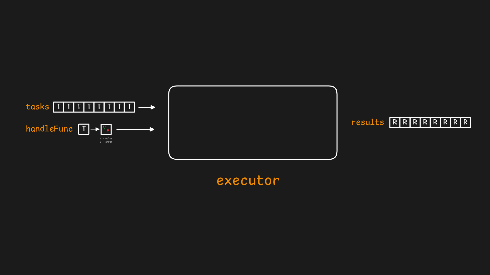
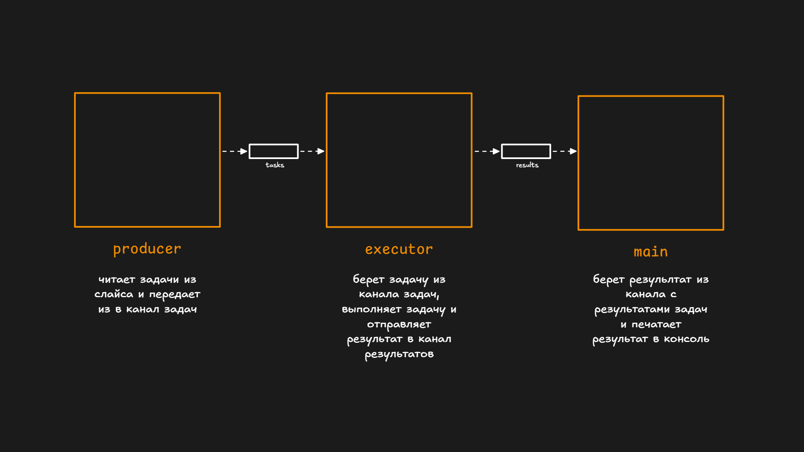

# Worker pool

В этом примере мы разберем один из самых полехных паттернов в мире `go` - `Worker pool`.

Начнем со следующего примера. Есть некоторая задача `Task`, которую нужно обработать (собрать какие то данные, трансформировать, агрегировать и т.д.). Задачи имеет некоторые данные `Data` и это может быть все что угодно.

```go
type Task[T any] struct {
	ID   int
	Data T
}

func NewTask[T any](id int, data T) *Task[T] {
	return &Task[T]{
		ID:   id,
		Data: data,
	}
}
```

Задача хранит в себе все, что нужно для ее выполнения но заниматься выполнением будет отдельная функция: `HandleFunc`, которая принимает задачу и возвращает результат и ошибку. В нашем примере будем симулировать выполнение некоторой задачи, которая занимает 1 секунду, возвращает свой же параметр `Data` и с вероятностью `1%` завершается с ошибкой.

```go
func HandleFunc(task *Task[int]) (int, error) {
	time.Sleep(time.Second)
	if rand.Float64() < 0.01 {
		return 0, fmt.Errorf("task with id %d failed", task.Id)
	}
	return task.Data, nil
}
```

Теперь выполнять задачу я могу так

```go
func HandleFunc(task *Task[int]) (int, error) {
	time.Sleep(time.Second)
	if rand.Float64() < 0.01 {
		return 0, fmt.Errorf("task with id %d failed", task.Id)
	}
	return task.Data, nil
}

func main() {
	task := NewTask(1, 42)
	result, err := HandleFunc(task)
	if err != nil {
		fmt.Println(err)
		return
	}
	fmt.Println(result)
}
```

С одной задачей это работает хорошо, но у много задач и мне хотелось бы иметь некоторую структуру (`executor` - выполнитель), которой я передам список задач, функцию обработки одной задачи и получить на выходе список результатов. Это можно изобразить следующим образом



Результатом будет специальная структура `TaskResult`, которая через `TaskId` свяжет результат с задачей, а также сохранит время выполнения, в течении которого выполнялась задача.

```go
type TaskResult[R any] struct {
	TaskId   int
	Value    R
	Err      error
	Elapsed  time.Duration
}

func (r *TaskResult[R]) String() string {
	if r.Err != nil {
		return fmt.Sprintf("task with id %d failed, err: %v (took time: %v)", r.TaskId, r.Err, r.Elapsed)
	}
	return fmt.Sprintf("task with id %d completed successfully with result %v (took time: %v)", r.TaskId, r.Value, r.Elapsed)
}
```

Напишем структуру `Executor`, которая при создании принимает функцию обработчик (`handleFunc`) и таким образом на этапе создания понимает, с какие типом задачи будет работать. Метод `Run` принимает список задач, выполняет `handleFunc` для каждой задачи и записывает результат в слайс, который возвращает.

```go
type Executor[T any, R any] struct {
	handleFunc func(task *Task[T]) *TaskResult[R]
}

func NewExecutor[T any, R any](handleFunc func(task *Task[T]) *TaskResult[R]) *Executor[T, R] {
	return &Executor[T, R]{
		handleFunc: handleFunc,
	}
}

func (e *Executor[T, R]) Run(tasks []*Task[T]) []*TaskResult[R] {
	results := make([]*TaskResult[R], 0, len(tasks))
	for _, task := range tasks {
		start := time.Now()
		value, err := e.handleFunc(task)
		elapsed := time.Since(start)
		result := &TaskResult[R]{
			TaskId:  task.ID,
			Elapsed: elapsed,
		}
		if err != nil {
			result.Err = err
		} else {
			result.Value = value
		}
		results = append(results, result)
	}
	return results
}
```

Посмотрим как это работает в `main`. Создадим 10 задач, отправим их в `executor`, получим и выведем результат

```go
func handleFunc(task *Task[int]) (int, error) {
	time.Sleep(time.Second)
	if rand.Float64() < 0.01 {
		return 0, fmt.Errorf("task with id %d failed", task.ID)
	}
	return task.Data, nil
}

func createTasks(N int) []*Task[int] {
	tasks := make([]*Task[int], N)
	for i := range N {
		tasks[i] = NewTask(i, i)
	}
	return tasks
}

func main() {
	N := 10
	tasks := createTasks(N)
	executor := NewExecutor(handleFunc)
	results := executor.Run(tasks)
	for _, result := range results {
		fmt.Println(result)
	}
}

// output
task with id 0 completed successfully with result 0 (took time: 1.00028508s)
task with id 1 completed successfully with result 1 (took time: 1.00027688s)
task with id 2 completed successfully with result 2 (took time: 1.00028298s)
task with id 3 completed successfully with result 3 (took time: 1.00025008s)
task with id 4 completed successfully with result 4 (took time: 1.00052078s)
task with id 5 completed successfully with result 5 (took time: 1.000308381s)
task with id 6 completed successfully with result 6 (took time: 1.00022938s)
task with id 7 completed successfully with result 7 (took time: 1.000235581s)
task with id 8 completed successfully with result 8 (took time: 1.00026348s)
task with id 9 completed successfully with result 9 (took time: 1.000208281s)
```

Сейчас приходится ждать пока все задачи завершатся, чтобы получить результат по каждой задаче. Можно использовать каналы и запустить обработку в отдельной горутине, тогда я буду получать результат как только моя задача завершится. Лучше всего разделить весь процесс на 3 горутины

- `producer` - чтение из слайса задач и отправка их в канал с задачами
- `executor` - получение задачи из канала задач, обработка и отправка результатов в канал с результатами
- `main` - печать в консоль результата задачи



Горутина `producer` выглядит так (эта горутина закрывает канал `tasks`)

```go
func createTasks(N int) <-chan *Task[int] {
	tasks := make(chan *Task[int])
	go func() {
		defer close(tasks)
		for i := range N {
			task := NewTask(i, i)
			tasks <- task
		}
	}()
	return tasks
}
```

Горутина `executor` выглядит так (эта горутина закрывает канал `results`). Заметим что из `tasks` метод `Run` может только читать, в `results` только писать.

```go
func (e *Executor[T, R]) Run(tasks <-chan *Task[T], results chan<- *TaskResult[R]) {
	go func() {
		defer close(results)
		for task := range tasks {
			start := time.Now()
			value, err := e.handleFunc(task)
			elapsed := time.Since(start)
			result := &TaskResult[R]{
				TaskId:  task.ID,
				Elapsed: elapsed,
			}
			if err != nil {
				result.Err = err
			} else {
				result.Value = value
			}
			results <- result
		}
	}()
}
```

Горутина `main` основная и выглядит так

```go
func main() {
	N := 10
	tasks := createTasks(N)
	executor := NewExecutor(handleFunc)
	results := make(chan *TaskResult[int])
	executor.Run(tasks, results)
	for result := range results {
		fmt.Println(result)
	}
}
```

Запустим пример заново и увидим тот же результат, с той лишь разницей что в консоли появятся не 10 строк через 10 секунд, а по строке через каждую секунду.

Основной недостаточк текущего `executor` в том, что он работает последовательно. Пока задача `N` не обработана, выполнение задачи `N+1` не начнется. Измением метод `Run` самым простым способом - будем запускать каждую задачу в новой горутине.  Поменяем структуру и вместо

```go
go func() {
    for task := range tasks {
        // ...
    }
}()
```

будем использовать

```go
for task := range tasks {
    go func() {
        // ...
    }()
}
```

Теперь у нас будет много горутин и сразу стоит задуматься о синхронизации. Метод `Run` должен закрыть канал `results`, но сделать это нужно только один раз (закрытие закрытого канала - это паника). Мы будем использовать тот файт, что каждая горутина знает когда она завершит свое выполнение (когда дойдет до конца). В самом начале мы просто прочитаем все задачи из `tasks`, увеличим счетчик `WaitGroup` на количество задач, затем запустим такое же количество горутин. Каждая горутина в конце уменьшит счетчик `WaitGroup` на 1 и когда он будет равен 0 - все горутины отработали (за этот функционал отвечает `wg.Go`), канал `tasks` закрыт, можно заркывать `results` (но сделать это нужно в отдельной горутине, потому что иначе мы заблокируем основную горутину).

```go
func (e *Executor[T, R]) Run(tasks <-chan *Task[T], results chan<- *TaskResult[R]) {
	var wg sync.WaitGroup
	for task := range tasks {
		wg.Go(func() {
			start := time.Now()
			value, err := e.handleFunc(task)
			elapsed := time.Since(start)
			result := &TaskResult[R]{
				TaskId:  task.ID,
				Elapsed: elapsed,
			}
			if err != nil {
				result.Err = err
			} else {
				result.Value = value
			}
			results <- result
		})
	}
	go func() {
		wg.Wait()
		close(results)
	}()
}
```

Плохо в этом решении то, что мы запускаем на каждую задачу новую горутину. Да, горутины намного дешевле чем поток ОС, но они не бесплатны. Кроме того, ресурсы, которые потребляют горутины (файловые дескрипторы, центральный процессор, лимиты на запросы к API) не позволют выполняться N горутин параллельно, они все равно будут ожидать какого-то ресурса, что не приведет к повышению производительности а только наоборот, множество горутин будут большую часть времени ожидать права на выполнение. Одна горутина на все задачи - это плохо (медленно). Одна горутина на одну задачу - тоже плохо (из-за высокой конкурентности). Должная быть золотая середина - `N` горутин на все задачи, и подобрать лучшее значение `N` зачастую можно только экспериментально (оно зависит от множества деталей выполняющихся задач).

Следующая версия метода `Run` первым параметром принимет `workersCount` - сколько горутин будут выполнять задачи. Каждая горутина пытается получить задачу из общей очереди задач `tasks`. Очень похоже на предыдущий пример. Добавим в `TaskResult` номер горутины (или номер воркера), который обрабатывал эту задачу.

```go
type TaskResult[R any] struct {
	TaskId   int
	WorkerId int
	Value    R
	Err      error
	Elapsed  time.Duration
}

func (r *TaskResult[R]) String() string {
	if r.Err != nil {
		return fmt.Sprintf("task with id %d failed, err: %v (took time: %v, workerId: %d)", r.TaskId, r.Err, r.Elapsed, r.WorkerId)
	}
	return fmt.Sprintf("task with id %d completed successfully with result %v (took time: %v, workerId: %d)", r.TaskId, r.Value, r.Elapsed, r.WorkerId)
}

```

```go
func (e *Executor[T, R]) Run(workersCount int, tasks <-chan *Task[T], results chan<- *TaskResult[R]) {
	var wg sync.WaitGroup
	for workerId := range workersCount {
		wg.Go(func() {
			for task := range tasks {
				start := time.Now()
				value, err := e.handleFunc(task)
				elapsed := time.Since(start)
				result := &TaskResult[R]{
					TaskId:   task.ID,
					WorkerId: workerId,
					Elapsed:  elapsed,
				}
				if err != nil {
					result.Err = err
				} else {
					result.Value = value
				}
				results <- result
			}
		})
	}
	go func() {
		wg.Wait()
		close(results)
	}()
}
```

Запустим метод `Run` с `workersCount` = 2 и увидим как каждую секунду появляется результаты для 2-х задач

```sh
task with id 1 completed successfully with result 1 (took time: 1.00031163s, workerId: 1)
task with id 0 completed successfully with result 0 (took time: 1.00039713s, workerId: 0)
task with id 2 completed successfully with result 2 (took time: 1.000327274s, workerId: 1)
task with id 3 completed successfully with result 3 (took time: 1.001144974s, workerId: 0)
task with id 4 completed successfully with result 4 (took time: 1.000638243s, workerId: 1)
task with id 5 completed successfully with result 5 (took time: 1.000107943s, workerId: 0)
task with id 6 completed successfully with result 6 (took time: 1.000181143s, workerId: 1)
task with id 7 completed successfully with result 7 (took time: 1.000228444s, workerId: 0)
task with id 8 completed successfully with result 8 (took time: 1.000961443s, workerId: 1)
task with id 9 completed successfully with result 9 (took time: 1.000616843s, workerId: 0)
```

Развивать и изменять `executor` можно множеством способов, поэтому сделаем его в более удобнов для исползовании виде. Я хочу следующий API
- `Start` - запускает `executor` и возвращаем мне канал с результатами, из которого я могу читать
- `Submit` - добавить новую задачу в `executor`
- `Stop` - остановить `executor`, при этом мне нужно чтобы все задачи которые уже есть в `executor` выполнились

Начнем со структуры `Executor`

```go
type Executor[T any, R any] struct {
	running      bool
	mu           sync.Mutex
	handleFunc   func(task *Task[T]) (R, error)
	tasks        chan *Task[T]
	results      chan *TaskResult[R]
	stopCh       chan struct{}
	wg           sync.WaitGroup
}
```

Метод `Start` начинает работу `executor` и возвращает канал, из которого можно получать результаты. И канал для задач, и канал для результатов имеют некоторый буфер (в данном примере равный `workersCount`), но это значение лучше подбирать под конкретную задачу.

```go
func (e *Executor[T, R]) Start(workersCount int) (<-chan *TaskResult[R], error) {
	e.mu.Lock()
	if e.running {
		return nil, errors.New("executor already running")
	}
	defer e.mu.Unlock()
	e.running = true
	e.tasks = make(chan *Task[T], workersCount)
	e.results = make(chan *TaskResult[R], workersCount)
	e.stopCh = make(chan struct{})
	e.wg.Add(workersCount)
	for workerId := range workersCount {
		go e.run(workerId)
	}
	return e.results, nil
}
```

Метод `run` запускается в отдельной горутине и выполняет основную логику. У каждой задачи появилось новое поле `ctx`, позволяющее отменить выполнение задачи.

```go
func (e *Executor[T, R]) run(workerId int) {
	defer e.wg.Done()
	for {
		for task := range e.tasks {
			start := time.Now()
			value, err := e.handleFunc(task)
			elapsed := time.Since(start)
			result := &TaskResult[R]{
				TaskId:   task.ID,
				WorkerId: workerId,
				Elapsed:  elapsed,
			}
			if err != nil {
				result.Err = err
			} else if task.ctx.Err() != nil {
				result.Err = task.ctx.Err()
			} else {
				result.Value = value
			}
			e.results <- result
		}
	}
}
```
Метод stop закрывает канал с задачами. Оставшиеся в буфере задачи будут выполнены, но новые задачи больше не принимаются. Затем мы ждем когда каждая горутина завершит свое выполнение и только после этого закрываем канал с результатами.

```go
func (e *Executor[T, R]) Stop() {
	e.mu.Lock()
	if !e.running {
		e.mu.Unlock()
		return
	}
	e.running = false
	e.mu.Unlock()
	close(e.stopCh)
	close(e.tasks)
	e.wg.Wait()
	close(e.results)
}
```

Метод `Submit` кажется самым простым, но здесь могут быть проблемы с отправкой в закрытый канал

```go
func (e *Executor[T, R]) Submit(task *Task[T]) error {
	e.mu.Lock()
	if !e.running {
		e.mu.Unlock()
		return errors.New("executor not running")
	}
	e.mu.Unlock()
	select {
	case e.tasks <- task:
		return nil
	case <-e.stopCh:
		return errors.New("executor stopped")
	}
}
```

В конце обязательно нужно вызвать `Stop`.

Итоговая версия находится в файле `executor.go`.


